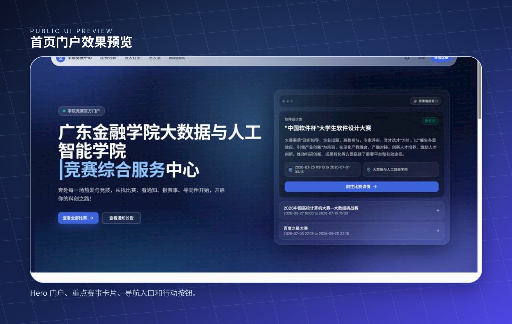
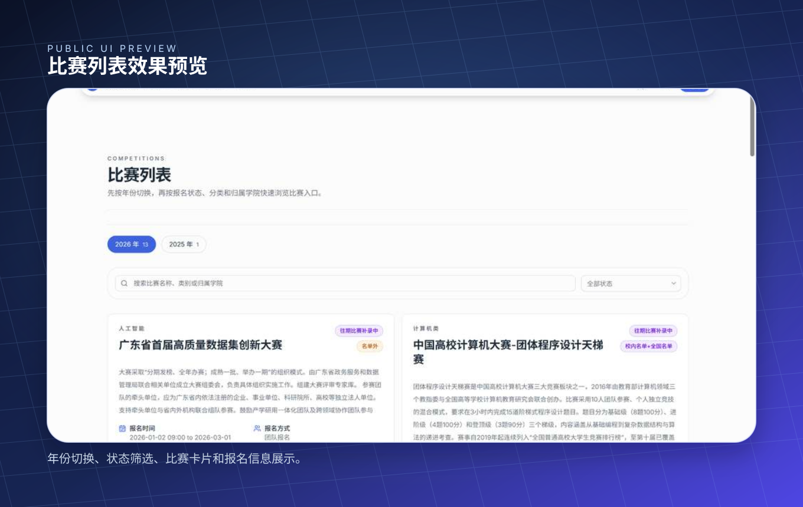

# 功能介绍

源码核对：2026-10-15，Web `0b0d594952897ea1d90c39b7afb5b7430571f078`。本页描述当前页面和配套 API 消费流程；部署和设备证据见[测试与验收](./测试与验收.md)。

## 公开门户与用户功能

| 范围 | 已有页面/行为 | 数据与限制 |
| --- | --- | --- |
| 首页/比赛 | 精选、年份导航、搜索/筛选/分页、详情、官网/推文与校内报名 | 公开 DTO 经 SSR 读取，比赛默认每页 20、最多 50；当前页不做二次过滤 |
| 通知 | 通知中心、铃铛/弹窗、已读及打开比赛跳转 | 导航使用最多 20 条 SSR 通知；登录已读同步，匿名沿本地状态 |
| 社团 | 固定社团总览、联系方式、招新/活动/公告/回顾与公开内容 | API 判断公开资格/图片可见性，社团元资料来自固定配置 |
| 荣誉/人物 | 奖状长廊、单证书、名人堂、人物与经验 | 年度 A/B/C 结构尚属计划，不是现有路由 |
| 网站团队 | 团队介绍 | 资料由代码维护，无配套 CRUD 后台 |
| 认证 | 学生/教师注册、验证码、登录、找回/重置、退出 | trusted 接入真实身份；API 处理账号与签名，教师注册不等于管理授权 |
| 报名 | 动态表单、团队/指导老师、提交、本人/队员记录、编辑/撤回/取消与时间线 | API 校验时间/归属/状态/事务；团队成员可见不代表可编辑或可看全部 PII |
| 问答 | 比赛作用域列表/详情、回答、树形评论、采纳/治理 | SSR 搜索分页，命令走显式 BFF；详情返回操作能力 |
| 个人工作台 | 资料/头像、奖状、受邀经验与名人堂 | 经验/名人堂不支持任意自助创建；旧社团入口转统一后台 |

## 管理与社团操作

| 范围 | 当前能力 | 关键边界 |
| --- | --- | --- |
| 比赛/赛程 | CRUD、状态/时间、报名配置，简版赛程时间线 | 编辑先取完整详情，不从列表摘要拼；失败保留输入 |
| 报名管理 | 授权范围读取、审核/批量动作、单赛事 CSV/XLSX | PII 读取/导出独立授权，菜单权限不能替代 |
| 用户管理 | 状态、平台/比赛角色和社团赋权 | 社团 grant/revoke 独立提交，用当前 assignment ID |
| 内容管理 | 通知、奖状管理/首页展示、经验邀请/审核、名人堂 | 按 API permissions/capabilities 展示，写入仍复核 |
| 社团工作台 | 唯一后台入口、封面必传、直接发布与已发布编辑 | API 返回当前有效赋权与 allowedActions，内容类型创建后锁定 |
| 社团治理/设置 | 已发布内容强制下线、联系方式 | 治理不自动授予全站编辑；设置仅全局管理员 |
| 固定分析 | 指标/趋势/漏斗/风险 | SQL 查询台已删除，统计和分数不表示因果结论 |
| 安全中心 | 事件、告警、动作/回执、白名单/地域策略、态势 SSE | 当前真实执行器仅 IP 放行/回滚，其他动作返回未实现 |

社团流程：选择有权社团 → 新建并完成封面上传 → 保存草稿或保存后发布 → 已发布内容保存即更新公开版本。下线内容编辑仍私有，重新公开须显式发布。发布失败保留已存草稿/revision；409 保留输入并重新核对；封面替换失败保留旧值，上传中阻止按钮和键盘提交。合同与退役入口见[HTTP 参考](./HTTP接口参考.md)。

富文本由浏览器 DOM 持有，本地回声/组合输入/格式工具不反复重写 innerHTML；切换文章重建 editorKey，晚到数据不覆盖脏输入。粘贴纯文本，保存/展示仍沿清洗边界；Markdown 不启用原始 HTML。

## 模式与剩余工作

public 提供公开 SSR 页面和受限素材/跳转，不转发身份 Cookie、不接受业务写入；仍需可用 API，不使用 Mock fallback。认证/报名/本人/管理需要 trusted 双仓联调，见[环境说明](./开发环境与HTTP边界.md)。

社团新流程与合成演练已有交付，真实 S3 重启/重新部署持久性、OS IME/手机/微信、存量补封面和生产切换仍待验收。浏览器兼容、视觉改版、组队审批、荣誉年度结构、GeoIP 每日补全按 Issue 规划，不能据需求文档宣称已实现；Regex 默认关闭。当前任务见 [Project #2](https://github.com/orgs/gduf-community/projects/2)。

## 展示素材

以下是效果示意，不是当前版本浏览器验收截图。

| 首页门户 | 比赛列表 |
| --- | --- |
|  |  |

[品牌示意](./assets/brand-banner.svg)仅作展示说明。完整路径见[页面与流程](./页面结构与用户流程.md)。

返回[文档入口](./README.md)。
